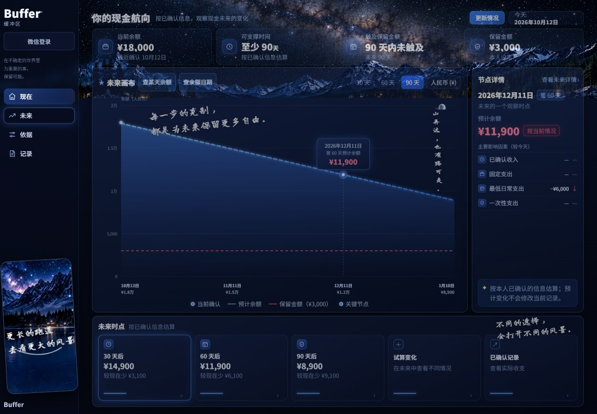
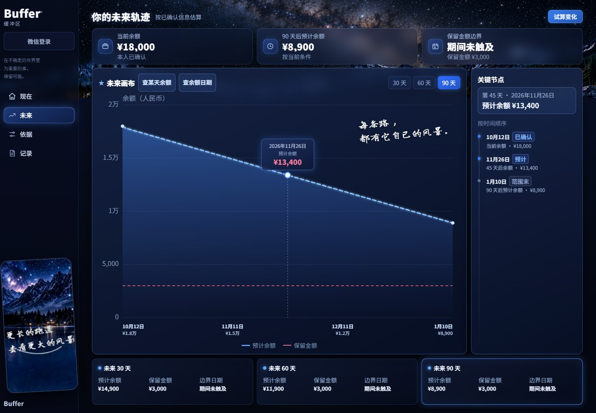

# Lokesh Cheng

### AI 产品设计与系统化构建

关注 **AI 应用、复杂信息组织与交互体验**，通过个人项目探索从产品定义到可运行应用的完整过程。

我的实践围绕一条主线展开：将现实场景中的模糊需求转化为明确的产品结构，通过交互设计、数据模型与 AI 工作流组织解决方案，并在实际运行中验证和迭代。现有作品覆盖个人现金状态、多智能体情景模拟、自动化信息筛选与角色化对话，呈现了我在**需求拆解、产品架构、体验设计和实现推进**上的综合实践。

## 代表作品

| 项目 | 产品定位 | 核心实践 |
| --- | --- | --- |
| [**Buffer · 缓冲区**](https://github.com/cheng-Lokesh/buffer) | 个人现金状态与未来情景模拟工具 | 信息架构、现金可视化、自然语言交互、多端一致性 |
| [**Astraloom**](https://github.com/cheng-Lokesh/Astraloom) | 证据链驱动的多智能体情景模拟系统 | 复杂场景建模、人物关系图谱、可解释 AI 流程 |
| [**TradeSniper**](https://github.com/cheng-Lokesh/tradesniper) | 二手商品自动化监控与智能筛选工具 | 浏览器自动化、规则与模型协同、过程可视化 |
| [**星夜伴侣**](https://github.com/cheng-Lokesh/StarNight_Companion) | 多角色、场景化 AI 对话产品原型 | 角色体验、上下文编排、会话记忆、语音交互 |

---

## Buffer · 缓冲区

**个人现金状态与未来情景模拟｜Web 与微信小程序**

Buffer 面向收入不稳定时期的现金管理需求，将当前余额、持续收支和已知事项转化为可查询、可解释的未来轨迹。产品围绕“现实确认—未来推演—假设对照—变化复盘”构建使用流程，帮助用户理解现金状况、预计可支撑时间，以及不同收支条件对未来余额的影响。

当前网站实机界面 · 演示数据

### 产品设计与实现

- **信息架构：** 以“现在、未来、依据、记录”组织核心任务，将现金概览、未来趋势、计算依据与历史变化连接为连续体验。
- **可视化交互：** 以 30 / 60 / 90 天轨迹呈现余额变化，支持按日期查询余额、按金额定位时间，并解释关键节点的计算依据。
- **情景模拟：** 支持组合一次及周期收支、金额调整和条件暂停，比较多项变化对同一未来轨迹的共同影响。
- **自然语言交互：** 将生活变化整理为可核对的结构化候选，经程序校验与用户确认后写入，降低维护成本并保留数据控制权。
- **多端设计：** 结合响应式网站与小程序开发，共用核心现金规则，推进计算与操作流程的一致性。

### 关键产品判断

将已确认现实、未来预测和临时假设分别管理，使试算保留探索空间，同时不改变真实记录；将 AI 的作用限定在语言理解与信息整理，确保业务计算和事实确认具有明确依据。

**项目价值：** 展示从复杂业务规则到清晰用户体验的转化能力，以及对数据准确性、AI 交互和多端产品一致性的系统考虑。

查看未来轨迹界面

当前网站实机界面 · 演示数据

**技术实现：** JavaScript · Node.js · 微信小程序 · LLM 结构化解析 · CloudBase / PostgreSQL · EdgeOne

[查看项目 →](https://github.com/cheng-Lokesh/buffer)

---

## Astraloom

**证据链驱动的多智能体情景模拟**

Astraloom 面向人物关系、职业选择与家庭压力等高不确定性场景，将现实背景整理为人物档案和关系图谱，再通过多角色事件模拟呈现可能的变化路径。产品强调从输入、模拟过程到结论的关联，让用户能够检查结果依据、识别未知信息，并通过反馈继续修正理解。

### 产品设计与实现

- **复杂场景结构化：** 将背景、目标、约束和关键人物组织为可检查的中间结果，支持用户逐步确认。
- **关系与角色建模：** 通过人物档案及关系图谱表达立场、支持与压力，以确认后的图谱快照作为模拟输入。
- **结果可解释：** 将重要结论关联到具体模拟事件，提供从结果回溯过程的证据路径。
- **可信流程设计：** 区分现实事实、模型推断和未知信息，将账户隔离与高风险场景处理纳入系统设计。

**项目价值：** 展示 AI 产品流程设计、复杂信息建模与可解释性设计的实践，探索如何让生成结果具备可检查的过程和依据。

**技术实现：** Next.js · React · TypeScript · Supabase · React Flow · Three.js

[查看项目 →](https://github.com/cheng-Lokesh/Astraloom)

---

## TradeSniper

**二手商品自动化监控与智能筛选｜桌面原型**

TradeSniper 面向二手商品检索中的重复浏览与信息干扰，将关键词巡检、商品整理、规则过滤和 AI 语义分析连接为自动化筛选流程。用户通过桌面面板查看候选商品、筛选理由与运行日志，集中处理更有相关性的信息。

### 产品设计与实现

- **任务自动化：** 根据关键词及价格范围巡检商品列表，维护浏览器登录会话。
- **分层筛选：** 先通过卖家特征、库存模式和价格规则过滤，再由模型分析候选描述，组织排序与判断理由。
- **过程可观察：** 在桌面界面呈现采集、过滤、异常与候选结果，保留人工判断环节。

**项目价值：** 展示将重复操作转化为自动化工作流的能力，以及规则、模型和人工判断之间的职责设计。

**技术实现：** Python · Playwright · Tkinter · DeepSeek API

[查看项目 →](https://github.com/cheng-Lokesh/tradesniper)

---

## 星夜伴侣 · StarNight Companion

**多角色、场景化 AI 对话｜Web 原型**

星夜伴侣围绕角色一致性、场景代入与连续对话体验，整合角色设定、历史记忆、语音合成和界面反馈。用户可在五个预设角色与多种场景之间切换，各角色独立维护会话，支持历史恢复、多会话管理及内容导出。

### 产品设计与实现

- **上下文编排：** 将角色设定、当前场景和历史对话共同组织到每轮请求，维持角色与情境的连续性。
- **会话管理：** 分别维护角色状态与本地记忆，支持会话恢复及多格式导出。
- **交互整合：** 协调文本回复、语音播放、情绪反馈与主题切换，处理异步等待、错误状态和移动端适配。

**项目价值：** 展示对话产品的信息组织、状态管理与体验设计实践，将模型能力转化为具有角色和场景连贯性的交互。

**技术实现：** Next.js · React · TypeScript · Zustand · Tailwind CSS · MiniMax 对话与语音接口

[查看项目 →](https://github.com/cheng-Lokesh/StarNight_Companion)

---

## 工作方法

**从需求建立产品结构。** 明确用户目标、关键任务与功能边界，以信息架构和操作流程组织复杂需求。

**围绕体验配置 AI 能力。** 根据任务选择语言理解、语义分析、角色对话或多智能体模拟，并设计必要的核对与反馈机制。

**以实际运行推动迭代。** 将需求、界面、数据规则与应用实现连接起来，通过真实操作和自动化验证检查结果，持续改善产品体验。
